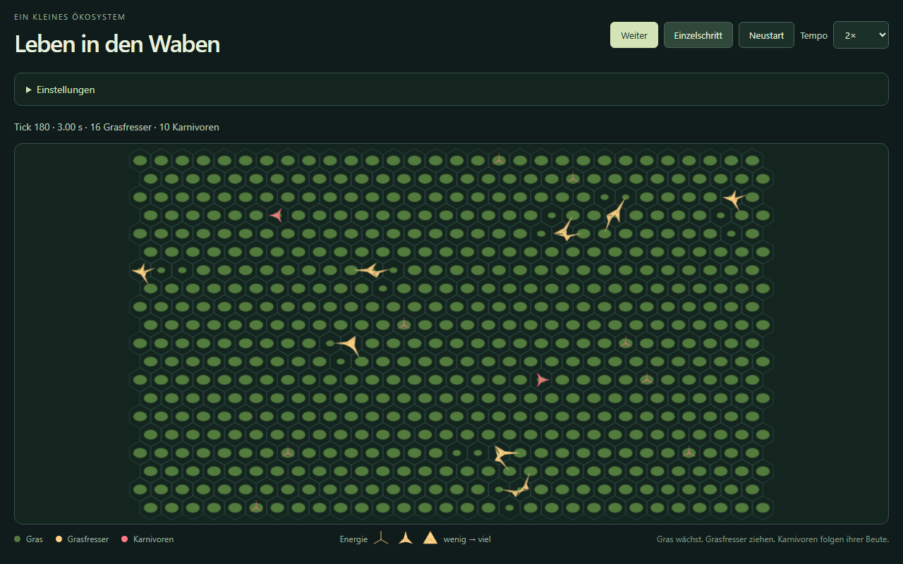
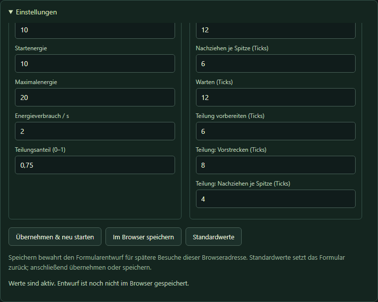

# Welt der Waben

[English](README.md) · **Deutsch**

Ein kleines Ökosystem auf einem Sechseckraster: Gras wächst, Grasfresser fressen und teilen sich, Karnivoren folgen ihrer Beute. Jede Begegnung macht den Energiefluss sichtbar – Schritt für Schritt.

Entwickelt mit TypeScript, Canvas 2D und Vite. Die Benutzeroberfläche ist derzeit deutsch.

**Online spielen:** [Welt der Waben öffnen](https://zebrajaeger.github.io/welt-der-waben/). Gehostet auf GitHub Pages und nach erfolgreichen Prüfungen auf `main` automatisch aktualisiert. Details stehen in der [Deployment-Anleitung](docs/deployment.md).

[Überblick](#überblick) · [Screenshots](#screenshots) · [Schnellstart](#schnellstart) · [Bedienung](#bedienung) · [Simulationsregeln](#simulationsregeln) · [Einstellungen und Einheiten](#einstellungen-und-einheiten) · [Entwicklung](#entwicklung)

## Überblick

- **Unabhängige Bewohner:** Bewegung, Nahrungsaufnahme und Teilung laufen asynchron mit 60 Ticks pro Simulationssekunde.
- **Sichtbarer Energietransfer:** Bewohner strecken eine Spitze in die Nachbarzelle, halten beim Aussaugen den Kontakt und vollenden danach ihren Schritt. Mehr übertragene Energie benötigt mehr Zeit.
- **Animierte Teilung:** Aus einem Bewohner entstehen zwei Hälften mit gleicher Energie. Bei genügend Platz gehen beide eigene Wege.
- **Veränderbare Einstellungen:** 24 Parameter anpassen, lokal im Browser speichern oder auf Standardwerte zurücksetzen.
- **Anpassbares Spielfeld:** Das gesamte Raster passt unverzerrt in die verfügbare Fensterfläche, auch während einer Pause.

## Screenshots



*Die Simulation während eines Laufs pausiert. Die Füllung der Symbole zeigt Energie; ausgestreckte Spitzen zeigen lokale Aktionen.*



*Die Einstellungsbox bis zu ihren Aktionen gescrollt. Ihr Inhalt scrollt unabhängig vom Spielfeld.*

## Schnellstart

Voraussetzungen: **Node.js ab 22.12** und npm.

```sh
git clone https://github.com/zebrajaeger/welt-der-waben.git
cd welt-der-waben
npm install
npm run dev
```

Die von Vite angezeigte Adresse öffnen. Bei bereits vorhandenem Repository reichen die letzten beiden Befehle im Projektverzeichnis.

## Bedienung

Die Tabelle verwendet die Beschriftungen der deutschen Oberfläche.

| Bedienelement | Funktion |
| --- | --- |
| **Pause / Weiter** | Sämtliche Vorgänge einfrieren oder an derselben Stelle fortsetzen. |
| **Einzelschritt** | Während einer Pause genau einen Tick weitergehen: 1/60 Simulationssekunde, auch mitten in einer Bewegung. |
| **Neustart** | Eine neue zufällige Welt mit den aktiven Einstellungen beginnen; Pausenmodus und aktuelles Tempo bleiben erhalten. |
| **Tempo** | Die Wiedergabe sofort zwischen 0,25× und 8× ändern. Bei 1× verstreichen 60 Ticks pro Realzeitsekunde, bei 2× sind es 120. |
| **Einstellungen** | Die Parameterbox auf- oder einklappen. |
| **GitHub-Symbol** | Neben „Ein kleines Ökosystem“ den Quellcode in einem neuen Tab öffnen. Auch mit Tab und Enter bedienbar. |

Die Statuszeile zeigt Tickzahl, vergangene Simulationszeit und Populationen beider Arten. Eine Fensteränderung verändert nur die Projektion. Bei unterschiedlichem Seitenverhältnis bleiben Restflächen um das zentrierte Raster.

## Simulationsregeln

| Bewohner | Darstellung | Verhalten |
| --- | --- | --- |
| Gras | Grüne Kreise oder Ovale | Wächst in jeder Zelle in kleinen Schritten bis zum Grasmaximum. |
| Grasfresser | Gelber dreizackiger Stern | Wählt eine verfügbare Nachbarzelle mit dem meisten Gras, ohne Karnivoren zu meiden. |
| Karnivor | Roter dreizackiger Stern | Beansprucht höchstens einen erreichbaren Grasfresser pro Jagd. |

Ein energiearmes Tier erscheint als drei dünne Arme. Mit steigender Energie füllt sich der Stern zu einem Dreieck.

### Nahrungsaufnahme und Bewegung

Zuerst erreicht die dem Ziel nächste Spitze dessen Zellzentrum. Beim Aussaugen halten alle Spitzen ihre Position; danach ziehen die beiden anderen nacheinander nach. Die führende Spitze wandert währenddessen zu ihrer Endposition. Ein Jäger stimmt seinen Kontakt auf die Ankunft der Beute ab.

Gras und Beuteenergie werden mit konstanter Rate übertragen: Eine größere Mahlzeit dauert länger. Nur nutzbare Nahrung wird entnommen. Überschüssiges Gras bleibt stehen, und ein teilweise ausgesaugter Grasfresser kann überleben. Überlebt die Beute, zieht sich der Jäger zurück; erst nach vollständigem Aufzehren nimmt er ihre Zelle ein. Andere Bewohner handeln und Gras wächst währenddessen weiter.

### Energie und Teilung

Beide Arten verbrauchen in jedem Tick Energie, auch beim Warten, Bewegen, Fressen oder Teilen. Bei aufgebrauchter Energie stirbt ein Tier. Ein eingeschlossener Grasfresser kann vom nachwachsenden Gras nicht dauerhaft leben.

Oberhalb seiner Teilungsschwelle kann sich ein Bewohner teilen, sobald mindestens eine Nachbarzelle frei ist. Seine verbleibende Energie wird gleichmäßig aufgeteilt. Bei zwei freien Nachbarn ziehen beide Hälften in unterschiedliche Richtungen; bei nur einem bleibt eine Hälfte stehen. Hinausziehende Grasfresserhälften fressen in ihren Zielzellen. Jede Hälfte beendet ihre eigene Bewegung und Wartezeit, bevor sie wieder selbst handelt.

Populationen können aussterben. **Neustart** beginnt einen neuen Zufallslauf.

## Einstellungen und Einheiten

Formularänderungen sind zunächst ein **Entwurf**, bis sie ausdrücklich übernommen werden. Die Box zeigt, ob die dargestellten Werte aktiv oder gespeichert sind.

| Aktion | Wirkung |
| --- | --- |
| **Übernehmen & neu starten** | Den Entwurf validieren und eine neue Welt bei Tick null beginnen. Eine pausierte Simulation bleibt pausiert. Speichert den Entwurf nicht. |
| **Im Browser speichern** | Den gültigen Entwurf für spätere Besuche speichern. Verändert den aktuellen Lauf nicht und startet ihn nicht neu. |
| **Standardwerte** | Die aktuellen Programmstandards ins Formular laden. Anschließend übernehmen, um damit zu starten, oder für spätere Besuche speichern. |
| **Als JSON exportieren** | Den vollständigen gültigen Formularentwurf als JSON-Datei herunterladen, ohne ihn zu übernehmen oder zu speichern. |
| **JSON importieren** | Eine lokale JSON-Einstellungsdatei auswählen und ins Formular laden. Anschließend für einen neuen Lauf übernehmen oder für spätere Besuche speichern. |

Die obere **Tempo**-Auswahl wirkt sofort und aktualisiert auch das Tempofeld im Entwurf; andere Änderungen bleiben erhalten. **Starttempo (×)** im Formular wird erst durch Übernehmen wirksam. Keine der beiden Aktionen speichert automatisch. **Neustart** verwendet aktive Werte und lässt offene Entwurfsänderungen bestehen.

### Parameter

Die Standardwerte stehen in [src/config.ts](src/config.ts). Alle Raten beziehen sich auf **Simulationszeit**; eine Simulationssekunde hat immer 60 Ticks.

| Gruppe | Parameter und Standardwerte |
| --- | --- |
| Feld | `width` × `height`: 30 × 20 Zellen mit festen Grenzen. |
| Gras | `grassMax`: 5; `grassGrowthPerSecond`: 0,25 je Zelle; `grassEfficiency`: 1. |
| Jagd | `preyEfficiency`: 0,5; `energyTransferPerSecond`: 8 Bruttoenergie pro Sekunde. |
| Wiedergabe | `speedMultiplier`: 2; verändert die Realzeitwiedergabe, nicht die Raten pro Simulationssekunde. |
| Je Art | `initialCount`: 10; `initialEnergy`: 10; `maxEnergy`: 20; `divisionFraction`: 0,75. |
| Energieverbrauch | `energyDrainPerSecond`: 2 für Grasfresser, 0,33 für Karnivoren. |
| Aktionszeiten | `approachTicks`: 12; `followTicks`: 6 je Spitze; `waitTicks`: 12; `swellTicks`: 6; `divisionApproachTicks`: 8; `divisionFollowTicks`: 4 je Spitze. |

Die Startenergie ist je Art unabhängig einstellbar. Sie muss größer als null und höchstens so groß wie die jeweilige Maximalenergie sein. Eine Änderung des Maximums ändert die Startenergie nicht automatisch. Gras startet mit der Hälfte seines Maximums, außer unter initialen Grasfressern: Dort startet es bei null.

Wachstum und Verbrauch werden auf die Ticks verteilt. Bei Transferrate 8 benötigen 4 übertragene Energie 30 Ticks und 8 benötigen 60 Ticks. Wirkungsgrade bestimmen die dafür entnommene Nahrungsmenge. Das Aufnahmebudget steht beim Kontakt fest; laufender Verbrauch verlängert die Mahlzeit nicht ständig.

Ungültige Konfigurationen werden mit einer Erklärung abgewiesen. Startpopulationen müssen ins Feld passen, Aktionszeiten sind positive ganze Tickzahlen und Teilungsanteile liegen strikt zwischen 0 und 1. Graswachstum mal Graswirkungsgrad muss kleiner als der Grasfresser-Verbrauch pro Simulationssekunde sein.

### Browserspeicher

In `localStorage` werden nur Einstellungen gespeichert, keine Tiere oder Tickstände. Die Speicherung gilt für diesen Browser und dieselbe Adresse einschließlich Protokoll und Port. Das Löschen der Browserdaten entfernt sie. Neuladen beginnt eine neue Welt mit gespeicherten Einstellungen oder den Programmstandards, falls keine gültigen Werte geladen werden können.

Ungültiger oder blockierter Speicher erzeugt einen Hinweis; Bearbeiten und Übernehmen bleiben nutzbar. Ältere Speicherungen ohne Startenergie behalten ihre Werte und verwenden die bisherige halbe Maximalenergie je Art als Startenergie.

### JSON-Einstellungsdateien

Mit **Als JSON exportieren** in der Einstellungsbox wird `welt-der-waben-settings.json` heruntergeladen. Die Datei enthält den Formularentwurf einschließlich Startenergien und Starttempo, auch wenn er noch nicht übernommen oder gespeichert wurde. Ungültige Entwürfe erzeugen einen Hinweis statt eines Downloads. Dateien enthalten ausschließlich Einstellungen; Tiere, Grasbestände, Tickstände und dieselbe zufällige Welt lassen sich damit nicht wiederherstellen.

Zum Übertragen **JSON importieren** öffnen und die heruntergeladene Datei in einem anderen Browser, auf einem anderen Gerät oder unter einer anderen Adresse auswählen. Nach erfolgreicher Prüfung ersetzt der Import den gesamten Formularentwurf. Laufende Welt, Pausenmodus, aktives Tempo und gespeicherte Einstellungen bleiben erhalten. **Übernehmen & neu starten** aktiviert die Werte; **Im Browser speichern** bewahrt sie nach dem Neuladen. Beides sind separate Aktionen.

Abbrechen sowie unlesbare, ungültige oder inkompatible Dateien lassen bestehende Werte unverändert und melden nötigenfalls die Ursache. Die Dateiverarbeitung bleibt auf dem Gerät und funktioniert auch bei blockiertem Browserspeicher. Dateien der Version 1 verwenden nach der Migration die halbe Maximalenergie je Art als Startenergie. Version 2 verlangt alle Parameter; unbekannte Versionen werden abgewiesen. Unbekannte Zusatzfelder werden ignoriert und beim nächsten Export weggelassen.

Dieses vollständige Beispiel enthält die aktuellen Standardwerte. Version und alle Parameternamen beibehalten; JSON-Zahlen verwenden einen Dezimalpunkt:

```json
{
  "version": 2,
  "config": {
    "width": 30,
    "height": 20,
    "grassMax": 5,
    "grassGrowthPerSecond": 0.25,
    "grassEfficiency": 1,
    "preyEfficiency": 0.5,
    "energyTransferPerSecond": 8,
    "speedMultiplier": 2,
    "approachTicks": 12,
    "followTicks": 6,
    "waitTicks": 12,
    "swellTicks": 6,
    "divisionApproachTicks": 8,
    "divisionFollowTicks": 4,
    "herbivore": {
      "initialCount": 10,
      "initialEnergy": 10,
      "maxEnergy": 20,
      "energyDrainPerSecond": 2,
      "divisionFraction": 0.75
    },
    "carnivore": {
      "initialCount": 10,
      "initialEnergy": 10,
      "maxEnergy": 20,
      "energyDrainPerSecond": 0.33,
      "divisionFraction": 0.75
    }
  }
}
```

## Entwicklung

| Befehl | Zweck |
| --- | --- |
| `npm run dev` | Vite starten; Quelltextänderungen werden automatisch im Browser aktualisiert. |
| `npm test` | Regeln, Geometrie, Einstellungen und Wiedergabe einschließlich Langzeitläufen prüfen. |
| `npm run build` | TypeScript prüfen und die Produktionsdateien in `dist/` erzeugen. |
| `npm run preview` | Den gebauten Stand lokal unter `/welt-der-waben/` ansehen. |
| `npm run test:production` | Den vorhandenen Produktionsbuild mit Chromium prüfen; Einrichtung siehe unten. |

Weiterführende Dokumentation:

- [Animation, Tickreihenfolge und Browserprüfung](docs/animation.md) — technische Hinweise auf Deutsch.
- [README-Screenshots erneuern](docs/screenshots.md) — Anleitung auf Englisch.
- [GitHub-Pages-Einrichtung und Produktions-Browserprüfung](docs/deployment.md) — Anleitung auf Englisch.
- [Lokale Zeitlupenbeispiele](scripts/grass-division-demo.html) — bei laufendem Vite unter dessen lokaler Adresse `/scripts/grass-division-demo.html` öffnen. Die Beispiele zeigen kurze und lange Mahlzeiten, Teilung und überlebende Beute.
